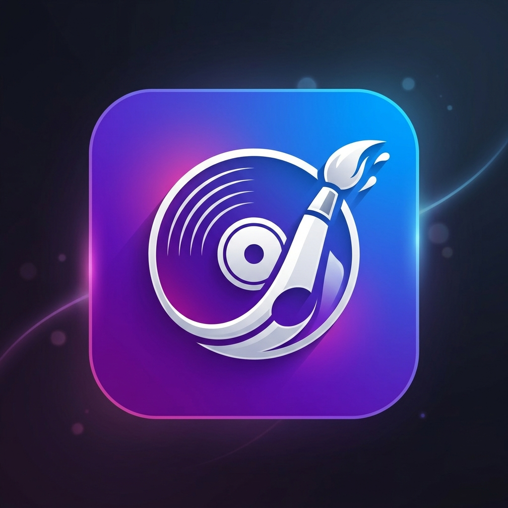

<p align="center">
  
</p>

<h1 align="center">🎨 AlbumCanvas</h1>

<p align="center">
  <b>Automatically set your phone's wallpaper to the album art of whatever you're listening to.</b>
</p>

<p align="center">
  
  
  
  
  
</p>

---

## ✨ Features

- 🎵 **Auto-detect currently playing music** via MediaSession and NotificationListener
- 🖼️ **Live Wallpaper** — album art updates your wallpaper in real-time
- 🎨 **Customizable effects** — blur, gradient overlays, color extraction
- 📊 **Listening statistics** — track your music habits
- 🔧 **Per-app player selection** — choose which music apps to monitor
- 📱 **Home screen widget** — quick toggle for the service
- 💾 **Artwork caching** — offline support with smart cache management
- ⚙️ **Export/Import settings** — backup and restore your configuration
- 🌙 **Dark theme** — beautiful Material 3 dark UI

## 🏗️ Architecture

```
AlbumCanvas/
├── app/src/main/java/com/example/albumcanvas/
│   ├── data/              # Repository, database, cache, preferences
│   │   ├── db/            # Room database (history, cached artwork, player apps)
│   │   └── pref/          # DataStore settings
│   ├── di/                # Hilt dependency injection modules
│   ├── service/           # MediaSession observer & WallpaperService
│   ├── theme/             # Material 3 theming (colors, typography)
│   ├── ui/
│   │   ├── main/          # Main screen + ViewModel
│   │   ├── screens/       # Home, Customization, Players, Settings, Statistics
│   │   └── viewmodel/     # Shared ViewModel
│   ├── utils/             # Image processing, notifications
│   └── widget/            # Home screen widget
├── gradle/                # Version catalog (libs.versions.toml)
└── previews/              # App screenshots and icon
```

## 🛠️ Tech Stack

| Layer | Technology |
|-------|-----------|
| **Language** | Kotlin 2.0 |
| **UI** | Jetpack Compose + Material 3 |
| **Architecture** | MVVM |
| **DI** | Hilt |
| **Database** | Room |
| **Preferences** | DataStore |
| **Annotation Processing** | KSP |
| **Build System** | Gradle (Kotlin DSL) + AGP 9.0 |

## 📦 Build & Install

### Prerequisites
- JDK 17+
- Android SDK (API 26+)
- A connected Android device with USB debugging enabled

### Build

```bash
# Clone the repository
git clone https://github.com/DarsheelShokeen/AlbumCanvas.git
cd AlbumCanvas

# Build debug APK
./gradlew assembleDebug

# Or install directly to connected device
./gradlew installDebug
```

The APK will be at `app/build/outputs/apk/debug/app-debug.apk`.

### Install on Phone
1. Transfer the APK to your phone (USB, Google Drive, Telegram, etc.)
2. Open the APK file on your phone
3. Allow installation from unknown sources if prompted
4. Install and launch **AlbumCanvas**

## 🚀 Setup After Install

1. **Open AlbumCanvas** and tap **"Set as Wallpaper"**
2. **Grant Notification Access** — go to Settings → Apps → Special Access → Notification Access → enable AlbumCanvas
3. **Play music** on any supported player (Spotify, YouTube Music, etc.)
4. Watch your wallpaper transform! 🎶

## 📱 Permissions

| Permission | Purpose |
|-----------|---------|
| `SET_WALLPAPER` | Change the device wallpaper |
| `FOREGROUND_SERVICE` | Keep the media observer running |
| `NOTIFICATION_LISTENER` | Read album art from music notifications |
| `POST_NOTIFICATIONS` | Show service status notification |
| `INTERNET` | Fetch high-res album artwork |

## 🖼️ Preview

<p align="center">
  
</p>

## 👨‍💻 Developer

**Darsheel Shokeen**

- GitHub: [@DarsheelShokeen](https://github.com/DarsheelShokeen)

## 📄 License

```
MIT License

Copyright (c) 2026 Darsheel Shokeen

Permission is hereby granted, free of charge, to any person obtaining a copy
of this software and associated documentation files (the "Software"), to deal
in the Software without restriction, including without limitation the rights
to use, copy, modify, merge, publish, distribute, sublicense, and/or sell
copies of the Software, and to permit persons to whom the Software is
furnished to do so, subject to the following conditions:

The above copyright notice and this permission notice shall be included in all
copies or substantial portions of the Software.

THE SOFTWARE IS PROVIDED "AS IS", WITHOUT WARRANTY OF ANY KIND, EXPRESS OR
IMPLIED, INCLUDING BUT NOT LIMITED TO THE WARRANTIES OF MERCHANTABILITY,
FITNESS FOR A PARTICULAR PURPOSE AND NONINFRINGEMENT. IN NO EVENT SHALL THE
AUTHORS OR COPYRIGHT HOLDERS BE LIABLE FOR ANY CLAIM, DAMAGES OR OTHER
LIABILITY, WHETHER IN AN ACTION OF CONTRACT, TORT OR OTHERWISE, ARISING FROM,
OUT OF OR IN CONNECTION WITH THE SOFTWARE OR THE USE OR OTHER DEALINGS IN THE
SOFTWARE.
```
